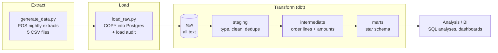
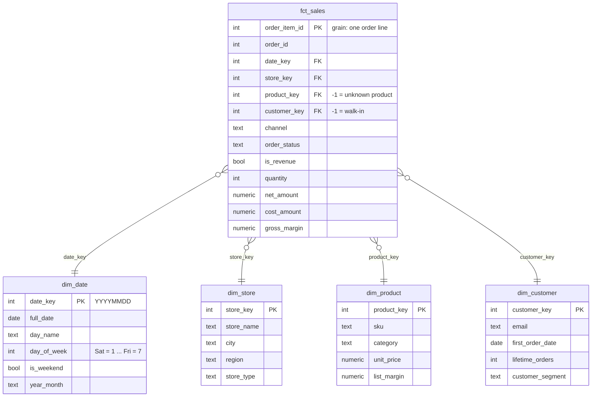

# Retail Data Warehouse

[](https://github.com/mahamed7/retail-data-warehouse/actions/workflows/ci.yml)


An end-to-end **ELT pipeline and dimensional data warehouse** for a retail chain.
Python extracts and loads messy point-of-sale data into PostgreSQL. dbt cleans it,
models it into a **star schema** and proves it is correct with **nearly 150 data tests**.
Every push rebuilds the whole warehouse from scratch in GitHub Actions.

> **The business:** *Dukaan Retail* is a fictional chain of 8 shops across Somaliland
> (Hargeisa, Borama, Berbera, Burao and more). It sells groceries, household goods and
> electronics, and takes cash, card and mobile money (Zaad, eDahab). All data is synthetic
> and generated deterministically, so every run produces identical numbers.

---

## Architecture



| Layer | Where | What happens |
| --- | --- | --- |
| **Extract** | `pipeline/generate_data.py` | Simulates the shop system's nightly export: about 25k orders and 59k order lines over 2024–2025, with realistic seasonality (Ramadan, Eid, December) and deliberate data-quality problems. |
| **Load** | `pipeline/load_raw.py` | Streams each CSV into the `raw` schema with `COPY`, one transaction per file. Columns land as `text` so a bad value can never break the load. Adds `_source_file` and `_loaded_at` and records row counts in `raw._load_audit`. |
| **Staging** | `warehouse/models/staging` | One view per source table: casts types, trims and lowercases emails, fixes name casing, removes duplicates. |
| **Intermediate** | `warehouse/models/intermediate` | `int_order_lines`: joins order lines to their orders and products and calculates gross, discount, net and cost amounts. |
| **Marts** | `warehouse/models/marts` | Star schema tables, indexed, for analysts and dashboards. |

## Star schema



There is also `mart_monthly_store_performance`, a reporting table with one row per store per month: orders, revenue, margin %, average order value and return rate.

## Data quality: what goes wrong and how it's handled

The source data has realistic problems on purpose. Each one is documented in the
[data contract](docs/data-contract.md), fixed in a specific model, and covered by a test.

| Problem in the source | Fix | Proven by |
| --- | --- | --- |
| ~2% of customer rows are exact duplicates | `distinct` after cleaning in `stg_customers` | `unique` on `customer_id` |
| Emails with stray spaces, capitals or blank values | `lower(trim())`, blank becomes `null` | |
| Names in random CAPS / lowercase | `initcap()` | |
| ~1% of orders re-sent after a status change | `row_number()` by `updated_at desc`; the latest version wins | `unique` on `order_id` |
| ~30% walk-in sales have no customer | mapped to a **Walk-in** member, `customer_key = -1` | `relationships` to `dim_customer` |
| ~0.1% of lines reference a product that doesn't exist | mapped to an **Unknown product** member, `product_key = -1`; the original id is kept and margin stays `null` | `relationships` (warn in staging, strict in marts) |
| Blank discount means zero | `coalesce(..., 0)` | `non_negative`, discount ≤ gross |
| Price at time of sale differs from today's list price | revenue uses the price at time of sale, never the list price | |

**Reconciliation tests** check that no money is created or lost between layers:

- `assert_fct_sales_revenue_reconciles_with_staging`: fact-table revenue equals revenue calculated straight from the cleaned source, to the cent.
- `assert_no_orders_lost_between_raw_and_fct_sales`: every raw order has the same number of lines in the fact table.
- `assert_monthly_mart_reconciles_with_fct_sales`: the reporting mart adds up to the fact table.
- `assert_order_ts_within_sales_period` and `assert_discount_not_exceeding_gross`.

The rest are generic tests: `unique`, `not_null`, `relationships`, `accepted_values`, and two custom generic tests written for this project (`non_negative`, `unique_combination_of_columns`). Source freshness is checked against `_loaded_at`.

## Run it yourself

You need Python 3.12 and Docker (or any PostgreSQL 16).

```bash
# 1. Start Postgres
docker compose up -d

# 2. Install dependencies
python -m venv .venv && source .venv/bin/activate   # Windows: .venv\Scripts\activate
pip install -r requirements.txt

# 3. Extract and load
python pipeline/generate_data.py      # writes data/raw/*.csv
python pipeline/load_raw.py           # lands them in the raw schema

# 4. Transform and test
cd warehouse
dbt build --profiles-dir .            # builds every model and runs every test
dbt docs generate --profiles-dir . && dbt docs serve --profiles-dir .   # browse lineage
```

Connection settings come from the standard `PGHOST`, `PGPORT`, `PGUSER`, `PGPASSWORD` and
`PGDATABASE` variables. Defaults match `docker-compose.yml`.

Then ask the warehouse questions. A few examples are in [`warehouse/analyses`](warehouse/analyses):

```sql
-- Revenue and margin by store for the latest month
select store_name, year_month, revenue, margin_pct, returned_rate
from marts.mart_monthly_store_performance
where year_month = '2025-12'
order by revenue desc;
```

## Continuous integration

[`.github/workflows/ci.yml`](.github/workflows/ci.yml) starts a PostgreSQL 16 service and runs
the whole pipeline on every push:

1. `pytest` unit tests for the generator and loader
2. Generate the extracts, then load them into `raw`
3. `dbt source freshness`
4. `dbt build`: every model plus every data test, so a failing test fails the build
5. `dbt docs generate`, uploaded as a build artifact

## Project structure

```
retail-data-warehouse/
├── pipeline/
│   ├── generate_data.py       # Extract: deterministic synthetic POS extracts
│   └── load_raw.py            # Load: COPY into raw schema + audit log
├── tests/                     # pytest unit tests for the pipeline
├── warehouse/                 # dbt project
│   ├── models/
│   │   ├── staging/           # stg_* views + sources and tests
│   │   ├── intermediate/      # int_order_lines
│   │   └── marts/             # dim_*, fct_sales, mart_monthly_store_performance
│   ├── macros/                # schema naming, helpers, custom generic tests
│   ├── tests/                 # singular reconciliation tests
│   └── analyses/              # business-question SQL
├── docs/data-contract.md      # source-to-warehouse agreement
├── docker-compose.yml
└── .github/workflows/ci.yml
```

## Design decisions

- **ELT, not ETL.** Raw data lands untouched as text, and all the logic lives in version-controlled, tested SQL. When a rule changes, the warehouse can be rebuilt from raw.
- **Unknown and walk-in members instead of dropping rows.** Revenue from an orphan product or an anonymous customer is still real revenue, so it stays in the totals and is visible in the dimension.
- **Natural integer keys.** The source ids are stable, so they serve as dimension keys. Slowly changing dimensions (SCD type 2 with dbt snapshots) are the next step for product prices.
- **Margin uses current cost.** The source only exports today's cost price, which is noted in the model docs. Historical cost would need a cost-history extract.
- **Local business calendar.** `dim_date.day_of_week` counts Saturday = 1 to Friday = 7, and `is_weekend` marks Friday, the main day off in Somaliland. `iso_day_of_week` is also exposed.

## Roadmap

- [ ] Orchestrate with Apache Airflow (daily DAG: extract → load → dbt build → alert)
- [ ] SCD type 2 product dimension with dbt snapshots
- [ ] Incremental `fct_sales` for daily loads
- [ ] Power BI / Metabase dashboard on the marts
- [ ] Great Expectations checks on the raw layer

## Author

**Saabir Dahir Mahamud**: aspiring Data Engineer, BSc Cybersecurity (4.0 GPA).
[Portfolio](https://mahamed7.github.io/Portfolio/) · [GitHub](https://github.com/mahamed7)

Licensed under the [MIT License](LICENSE).
