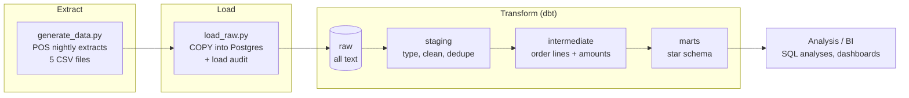
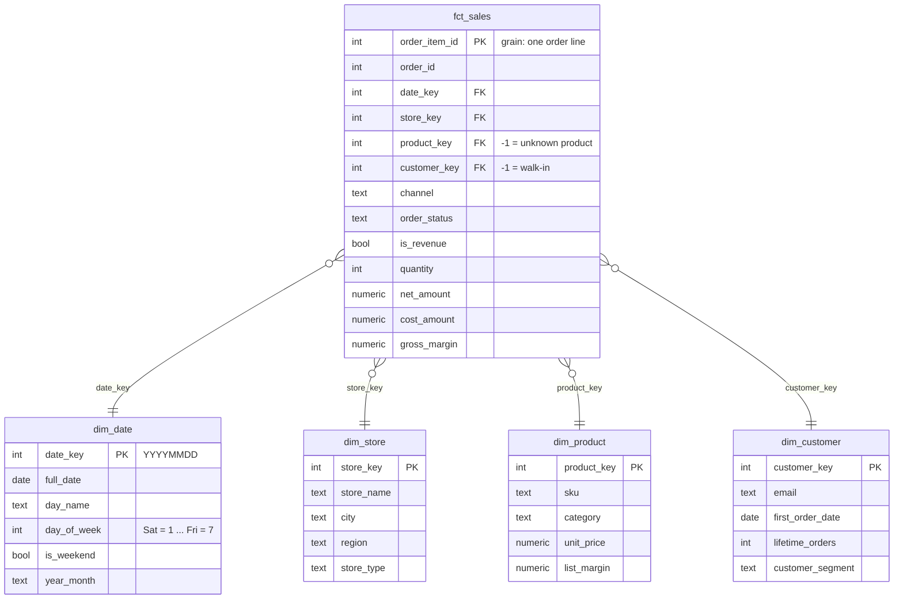

# Retail Data Warehouse

[](https://github.com/mahamed7/retail-data-warehouse/actions/workflows/ci.yml)


[](https://mahamed7.github.io/retail-data-warehouse/)
[](https://mahamed7.github.io/retail-data-warehouse/dbt-docs/)

An end-to-end **ELT pipeline and dimensional data warehouse** for a retail chain.
Python extracts and loads messy point-of-sale data into PostgreSQL. dbt cleans it,
models it into a **star schema** with **type 2 product history**, and proves it is correct with **177 data tests and a dbt unit test**.
Every push rebuilds the whole warehouse from scratch in GitHub Actions, replays it as
**idempotent daily batches**, and tests the **Airflow DAG** that schedules it. A **sales
dashboard** is built from the marts.

> **The business:** *Dukaan Retail* is a fictional chain of 8 shops across Somaliland
> (Hargeisa, Borama, Berbera, Burao and more). It sells groceries, household goods and
> electronics, and takes cash, card and mobile money (Zaad, eDahab). All data is synthetic
> and generated deterministically, so every run produces identical numbers.

---

## Architecture



| Layer | Where | What happens |
| --- | --- | --- |
| **Extract** | `pipeline/generate_data.py` | Simulates the shop system's nightly export: about 25k orders and 59k order lines over 2024–2025, with realistic seasonality (Ramadan, Eid, December) and deliberate data-quality problems. |
| **Load** | `pipeline/load_raw.py` | Streams each CSV into the `raw` schema with `COPY`, one transaction per file. Columns land as `text` so a bad value can never break the load. Adds `_source_file` and `_loaded_at` and records row counts in `raw._load_audit`. |
| **Staging** | `warehouse/models/staging` | One view per source table: casts types, trims and lowercases emails, fixes name casing, removes duplicates. |
| **Intermediate** | `warehouse/models/intermediate` | `int_order_lines`: joins order lines to their orders and products and calculates gross, discount, net and cost amounts. |
| **Marts** | `warehouse/models/marts` | Star schema tables, indexed, for analysts and dashboards. |

## Star schema



There is also `mart_monthly_store_performance`, a reporting table with one row per store per month: orders, revenue, margin %, average order value and return rate.

## Data quality: what goes wrong and how it's handled

The source data has realistic problems on purpose. Each one is documented in the
[data contract](docs/data-contract.md), fixed in a specific model, and covered by a test.

| Problem in the source | Fix | Proven by |
| --- | --- | --- |
| ~2% of customer rows are exact duplicates | `distinct` after cleaning in `stg_customers` | `unique` on `customer_id` |
| Emails with stray spaces, capitals or blank values | `lower(trim())`, blank becomes `null` | |
| Names in random CAPS / lowercase | `initcap()` | |
| ~1% of orders re-sent after a status change | `row_number()` by `updated_at desc`; the latest version wins | `unique` on `order_id` |
| ~30% walk-in sales have no customer | mapped to a **Walk-in** member, `customer_key = -1` | `relationships` to `dim_customer` |
| ~0.1% of lines reference a product that doesn't exist | mapped to an **Unknown product** member, `product_key = -1`; the original id is kept and margin stays `null` | `relationships` (warn in staging, strict in marts) |
| Blank discount means zero | `coalesce(..., 0)` | `non_negative`, discount ≤ gross |
| Price at time of sale differs from today's list price | revenue uses the price at time of sale, never the list price | |

**Reconciliation tests** check that no money is created or lost between layers:

- `assert_fct_sales_revenue_reconciles_with_staging`: fact-table revenue equals revenue calculated straight from the cleaned source, to the cent.
- `assert_no_orders_lost_between_raw_and_fct_sales`: every raw order has the same number of lines in the fact table.
- `assert_monthly_mart_reconciles_with_fct_sales`: the reporting mart adds up to the fact table.
- `assert_order_ts_within_sales_period` and `assert_discount_not_exceeding_gross`.

The rest are generic tests: `unique`, `not_null`, `relationships`, `accepted_values`, and two custom generic tests written for this project (`non_negative`, `unique_combination_of_columns`). Source freshness is checked against `_loaded_at`.

## Run it yourself

You need Python 3.12 and Docker (or any PostgreSQL 16).

```bash
# 1. Start Postgres
docker compose up -d

# 2. Install dependencies
python -m venv .venv && source .venv/bin/activate   # Windows: .venv\Scripts\activate
pip install -r requirements.txt

# 3. Extract and load
python pipeline/generate_data.py      # writes data/raw/*.csv
python pipeline/load_raw.py           # lands them in the raw schema

# 4. Transform and test
cd warehouse
dbt build --profiles-dir .            # builds every model and runs every test
dbt docs generate --profiles-dir . && dbt docs serve --profiles-dir .   # browse lineage
```

Connection settings come from the standard `PGHOST`, `PGPORT`, `PGUSER`, `PGPASSWORD` and
`PGDATABASE` variables. Defaults match `docker-compose.yml`.

Then ask the warehouse questions. A few examples are in [`warehouse/analyses`](warehouse/analyses):

```sql
-- Revenue and margin by store for the latest month
select store_name, year_month, revenue, margin_pct, returned_rate
from marts.mart_monthly_store_performance
where year_month = '2025-12'
order by revenue desc;
```

## Continuous integration

[`.github/workflows/ci.yml`](.github/workflows/ci.yml) runs three jobs on every push:

| Job | What it proves |
| --- | --- |
| **Full refresh** | `pytest` (78 tests), generate, load, `dbt source freshness`, `dbt build`, `dbt docs`, then export the dashboard data from the marts |
| **Daily batches** | Loads 2025-06-28 to 2025-07-03 **one day at a time** with `dbt build` after each day, then **replays a day** and asserts that row counts and revenue don't change (an idempotent load) |
| **Full history** *(in the full refresh job)* | Builds the same two years from **745 daily batches** in a second database, and asserts that lines and revenue match the full refresh exactly. The dashboard is exported from this point-in-time warehouse |
| **Airflow DAG integrity** | The `dukaan_daily_elt` DAG parses on Airflow 2.10, has the right task chain and schedule, and every command renders for a given run date (28 tests) |

### Daily batches (v2)

The source system can also export **one batch per day**. The loader appends a day in one
transaction per table: it deletes that day's rows, then reinserts them. Re-running a day is
always safe. From the CI run:

```text
run date     order rows   dbt build
2025-06-28   37           PASS=159 WARN=0 ERROR=0
2025-06-29   31           PASS=159
2025-06-30   35           PASS=159
2025-07-01   29           PASS=159   price rise: Basmati Rice 5kg 5.79 -> 6.25
2025-07-02   35           PASS=159
2025-07-03   41           PASS=159

replay 2025-07-01  -> "29 rows of 2025-07-01 replaced"
before replay: orders 208, items 500, customers 1827, products 720, revenue 2303.52
after replay:  orders 208, items 500, customers 1827, products 720, revenue 2303.52
```

See [`docs/data-contract.md`](docs/data-contract.md#daily-batches-v2) for the batch rules.

### History and incremental models (Phase 2)

Product prices and costs change over time (for example, a price rise on 2025-07-01), so
`dim_product_history` keeps one row per version and every sale is costed at the version in
force on its order date. From CI:

```text
product_version_key | version | unit_cost | unit_price | valid_from | valid_to   | is_current
             101001 |       1 |      4.24 |       5.79 | 1900-01-01 | 2025-07-01 | false
             101002 |       2 |      4.58 |       6.25 | 2025-07-01 |            | true

full refresh  (lines, revenue): 59194, 294099.35   margin with today's cost:     24.31%
daily history (lines, revenue): 59194, 294099.35   margin with point-in-time cost: 28.20%
                                                    (226 versions across 120 products)

incremental fct_sales after 6 days + a replay: 500 lines, 2439.01 net, 1750.83 cost
full rebuild (--full-refresh):                 500 lines, 2439.01 net, 1750.83 cost
```

The incremental run uses zero lookback, so it really picks up only the newly loaded lines. A
**dbt unit test** pins the versioning rules with mocked snapshots, and two singular tests check
that version intervals are contiguous and that every sale uses the version in force on its date.

### Orchestration

[`orchestration/`](orchestration) holds an Airflow 2.10 DAG that runs the whole flow daily with
catchup, so a backfill is a single command:

`extract → load → quality_gate → dbt_source_freshness → dbt_build → publish_dashboard_data`

It uses retries, timeouts, `depends_on_past` (days load in order) and a structured
`DUKAAN_ALERT` log line on failure. A Docker Compose stack runs Airflow with the warehouse
locally.

### Dashboard

**Live: [mahamed7.github.io/retail-data-warehouse](https://mahamed7.github.io/retail-data-warehouse/)**, with the [dbt docs and lineage graph](https://mahamed7.github.io/retail-data-warehouse/dbt-docs/) alongside.

[`dashboard/`](dashboard) is a static, no-build sales dashboard: KPI cards with year-on-year
change, monthly revenue 2024 vs 2025, a sortable store league table with sparklines, category and
channel/payment mix, and a "data quality handled" panel. `dashboard/export_data.py` regenerates its
JSON from the marts on every CI run.

### Results from a CI run

```text
pytest            36 passed
load_raw.py       86,612 rows loaded into raw in 0.38s
                  (customers 2,040 · orders 25,250 · order_items 59,194 · products 120 · stores 8)
source freshness  5 of 5 PASS
dbt build         PASS=158  WARN=1  ERROR=0   (12 models + 147 data tests)
```

The one warning is deliberate. The staging `relationships` test flags the **44 order lines**
that point at a product missing from the product extract. The lines are kept, mapped to the
*Unknown product* member, and the strict mart-level tests pass.

The `mart_monthly_store_performance` table for December 2025:

```text
        store_name        | year_month | revenue | margin_pct
--------------------------+------------+---------+------------
 Dukaan Berbera Port      | 2025-12    | 4078.84 |     0.2670
 Dukaan Hargeisa Central  | 2025-12    | 3034.12 |     0.2748
 Dukaan Wajaale Border    | 2025-12    | 2929.08 |     0.2773
 Dukaan Burao Main Street | 2025-12    | 2586.32 |     0.2922
 Dukaan Borama Market     | 2025-12    | 1683.62 |     0.2813
 Dukaan Erigavo           | 2025-12    |  816.18 |     0.3034
 Dukaan Gabiley           | 2025-12    |  580.62 |     0.2623
 Dukaan Sheikh            | 2025-12    |  465.61 |     0.2890
```

## Project structure

```
retail-data-warehouse/
├── pipeline/
│   ├── generate_data.py       # Extract: full extract or one batch per day
│   └── load_raw.py            # Load: full refresh or idempotent daily append
├── tests/                     # pytest unit tests for the pipeline
├── warehouse/                 # dbt project
│   ├── models/
│   │   ├── staging/           # stg_* views + sources and tests
│   │   ├── intermediate/      # int_order_lines
│   │   └── marts/             # dim_*, fct_sales, mart_monthly_store_performance
│   ├── macros/                # schema naming, helpers, custom generic tests
│   ├── tests/                 # singular reconciliation tests
│   └── analyses/              # business-question SQL
├── orchestration/             # Airflow DAG, local Airflow stack, DAG tests
├── dashboard/                 # static dashboard + export from the marts
├── docs/
│   ├── data-contract.md       # source-to-warehouse agreement (full + daily)
│   └── roadmap.md             # v2 phases and tasks
├── docker-compose.yml
└── .github/workflows/ci.yml
```

## Design decisions

- **ELT, not ETL.** Raw data lands untouched as text, and all the logic lives in version-controlled, tested SQL. When a rule changes, the warehouse can be rebuilt from raw.
- **Unknown and walk-in members instead of dropping rows.** Revenue from an orphan product or an anonymous customer is still real revenue, so it stays in the totals and is visible in the dimension.
- **Natural integer keys, plus versioned products.** The source ids are stable, so they serve as dimension keys. Products also have a type 2 `dim_product_history`, keyed `product_id * 1000 + version`.
- **SCD type 2 from raw history, not a dbt snapshot.** Daily batches keep every catalogue snapshot in `raw`, so versions are rebuilt with a gaps-and-islands window query. They are dated by business day and can be rebuilt at any time; a dbt snapshot would be dated by when dbt ran and could not be rebuilt.
- **Point-in-time cost.** Each sale joins the product version valid on its order date, so margin uses the cost in force then. A full extract carries only today's catalogue (one version per product), so CI also builds the warehouse from the full daily history, and the dashboard uses that.
- **Incremental fact table.** `fct_sales` uses `delete+insert` on `order_item_id` with a load-time watermark and a configurable lookback (`incremental_lookback_hours`), so late status changes still update old lines.
- **Local business calendar.** `dim_date.day_of_week` counts Saturday = 1 to Friday = 7, and `is_weekend` marks Friday, the main day off in Somaliland. `iso_day_of_week` is also exposed.

## Roadmap

The v2 plan, with every task and its "done when" condition, is in [`docs/roadmap.md`](docs/roadmap.md).

- [x] **Phase 1:** daily batch mode with idempotent loads
- [x] **Phase 2:** SCD type 2 products, point-in-time cost, incremental `fct_sales`
- [x] **Phase 3:** Airflow DAG with CI integrity tests *(local Docker stack not yet run end to end)*
- [ ] **Phase 4:** quality gate on each raw batch before dbt runs
- [x] **Phase 5:** [live dashboard](https://mahamed7.github.io/retail-data-warehouse/) built from the marts and published to GitHub Pages by CI

## Author

**Saabir Dahir Mahamud**: aspiring Data Engineer, BSc Cybersecurity (4.0 GPA).
[Portfolio](https://mahamed7.github.io/Portfolio/) · [GitHub](https://github.com/mahamed7)

Licensed under the [MIT License](LICENSE).
